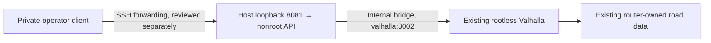

# Private national calculation prototype

Status: local security-review prototype, separate from `fairway.app:application`.
No deployment or public cutover is implied. Render is not required for this
national calculation path. The Pages map, catalog snapshots, and existing
Chicago/TomTom API remain unchanged. modo is a pinned Python dependency at
`257c680d6acf6917ac47df6521d44ab1b35f6d1a`, not a hosted relay.

## Contract and limitations

The separate `fairway-national-api` command binds `127.0.0.1:8081` by default.
It accepts only `GET /health` and `POST /api/national/rankings`:

```json
{"origins":[[41.9,-88.0],[42.0,-87.7]],"objective":"maximum","holes":[9,18]}
```

Coordinates above are synthetic test locations. `combined` is the other
objective. All three fields are required; unknown and duplicate fields fail.
There are no caller-selected URLs, destinations, dataset paths, commands,
engine options, departure times, or catalog uploads. There are no raw Valhalla,
filesystem, SSH, Docker, static-file or administration endpoints.

The pipeline calls modo's bounded lower-48 estimator, translates promising
areas, uses fairway's eligibility and spatial shortlist, and routes only the
shortlist through modo. It returns canonical integer millisecond times for
every golfer, both scores, ranking, and explicitly unranked destinations.
Provider outages fail the whole request; they never produce a partial ranking
or a fallback to Chicago/TomTom. Genuine unreachable/out-of-coverage
facilities can be unranked, as in the existing adapter contract.

Results identify the search as approximate, not a global optimum; timing is
traffic-unaware with no departure semantics. Search resolution and the separate
25 km facility catchment remain distinct. Metadata records the catalog ID,
checksum and date, matrix strategy, actual provider attempts and submitted
cells. The routing dataset label is operator-declared, not an independent
verification of Spark's tile bytes or freshness. Retain the router's separate
checksummed manifest and restore procedure. Road attribution remains OSM/ODbL.

The private API reuses the existing canonical catalog's packaged
`static/data/public-courses.json` projection. It admits the same 4,428 mapped
public facilities, preserving IDs, coordinates, physical hole totals, websites
and access notes. No new source requests, entrance verification pipeline,
canonical facts or public map changes are needed. Lower-48 origins and ordinary
road snapping/reachability checks still apply; this count is an input pool, not
proof that every property is reachable or national coverage is complete.

The response is schema version2 with `facilities` and `unranked_facilities`, one
routing target per property. `coordinate_basis=property_pin` means an approximate
arrival at the existing property point, not certified entrance directions.
Existing reviewed points retain their actual basis. `physical_holes` is the whole
facility total; `public_layout_holes` contains only explicitly retained public
9/18-hole layouts. Requesting both `[9,18]` means no specific layout preference
and includes unknown inventories with `layout_filter_status=unconfirmed`.
Requesting one hole count requires explicit public-layout evidence; totals of
9,18,27,36 or more never mint or infer course rows. Private nested layouts do not
satisfy the filter. Optional websites and access qualifications remain visible.

The pinned provider keeps its1-km input-to-road-snap guard. A destination with no
all-origin route is explicitly unranked; origin coverage failures and provider
outages still fail the whole request. Matrix results do not classify ferries,
private/cart-path approaches or timetable/access guarantees. Metadata says so;
no additional route lookups or false driving-only/entrance assurances are added.
Snapped coordinates/distances are not exposed by this thin adapter. Historical
Spark smoke results used the earlier eight-arrival prototype, and do not
validate this new candidate integration. Current facility behavior is tested
locally with synthetic routers; current container tests remain unexecuted.

## Enforced budgets

| Boundary | Policy |
| --- | --- |
| HTTP connection slots/backlog | 8 active, backlog 8; overflow 503 without a handler thread |
| Headers | 2 KiB request line, 8 KiB aggregate headers; 5 second header deadline |
| Body | 1-4,096 bytes; one Content-Length; UTF-8 application/json; 5 second absolute read deadline |
| Encoding | No chunked, compressed, duplicate-length or Expect bodies |
| Origins | 2-8 finite coordinate pairs, lower-48 gate; provider still validates road coverage |
| Candidate sampling | 81 coarse samples, 2 refinements, 6 anchors, at most 256 distinct matrix targets per request |
| Promising areas/shortlist | At most 8 areas, 25 km catchment; at most 24 facilities and 192 final matrix cells |
| Provider work | At most 32 HTTP attempts including failures, 4,096 submitted matrix cells including isolation, 40 targets per matrix, 128 points per locate batch |
| Provider transport | No redirects, retries or environment proxies; 5 second per-call socket timeout, 1 MiB successful response body |
| Calculation | One tracked child at a time, 30 second parent wall deadline including startup; bounded terminate/kill/reap cleanup; refuse new work if cleanup fails |
| Connection lifetime | 40 second absolute timer, one request per connection, no keepalive |
| Rate | Identifier-free burst 4, refill 1 per 10 seconds; 429 with Retry-After: 10 |

The killable child bounds the local API calculation independently of provider
socket timeouts or repeated coverage isolation. Normal server shutdown, SIGTERM
and SIGINT stop admission and clean up the tracked child: terminate, wait at
most 0.25 seconds, then kill and wait at most one second. If the child cannot be
reaped, the calculator refuses new work. Signal handlers only set a flag;
cleanup occurs in ordinary control flow rather than interrupting child creation.
Embedding callers must close their Calculator on shutdown. SIGKILL, a parent
crash or host failure cannot run this cleanup. A later supervisor must terminate
the entire process group/cgroup or container, with an outer stop deadline and
proof that no child survives; stopping only the parent is insufficient. No
supervisor has been installed by this prototype.

**Killing the API worker does not prove cancellation of a Valhalla job already
submitted.** The HTTP call may already be queued or executing in the router
when the client socket closes. The one-calculation API gate therefore does not
prove that only one upstream job is alive after API timeouts. Valhalla's actual
request timeout, queue, disconnect cancellation and effective resource behavior
remain unverified. Container resource configuration is an inspection result,
not evidence of job cancellation. No hostile/public workload or stress test is
authorized by this work; those remaining behaviors need a separately reviewed,
small test and operating policy before exposure.

The HTTP timers disconnect slow clients; no request coordinates or client identifiers enter access logs,
exception logs, cache or persistent state. Request coordinates exist in memory
while the calculation runs, and go to the configured private router. Router or
SSH tooling may have its own operational logging; inspect that policy before
inviting users. `/health` reports startup readiness only and makes no router
request; it is not a routing-health guarantee.

Errors use `{"error":{"code":"...","message":"...","retryable":false}}`.
Validation is 400/411/413/415; Origin rejection 403; unknown routes 404;
unsupported methods 405; coverage or no eligible/routable facilities 422;
rate exhaustion 429; upstream failure 502; busy/work/worker exhaustion 503;
hard calculation deadline 504. Messages exclude traceback, coordinates,
provider details, URLs, keys and paths. Protocol rejection uses the same JSON
shape. Disconnecting clients may receive no response.

## Private security boundary

This prototype is **unauthenticated** and must stay on trusted loopback/private
transport. It rejects every browser `Origin`, including Pages and `null`, and
emits no CORS permission. Origin rejection prevents accidental browser use; it
is not authentication, since a non-browser client can omit it. Network access
controls and HTTP authentication need their own later review. No browser
integration, login, credentials or protected public connection is installed.

The bounded transport uses Python's `http.server` for finite private tests.
[Python documents it as unsuitable for production](https://docs.python.org/3.12/library/http.server.html).
Before Internet exposure, review a hardened ingress/server boundary and preserve
these byte, time and overload limits in tests. A tunnel removes direct inbound
port exposure and hides an origin; its published application can still be
attacked. It does not secure the rest of Spark by itself. Container isolation
reduces host access; a compromised API can still attack the private router it
is allowed to contact, and kernel/runtime vulnerabilities remain relevant.

## Minimal portable deployment proposal, not executed

Use one nonroot API container and the existing rootless router, on a dedicated
**internal** bridge. Attach the existing `valhalla-us-261011` to that bridge
under alias `valhalla`; its existing host-loopback `8003 -> 8002` mapping stays.
Run the API with endpoint `http://valhalla:8002`, binding `0.0.0.0:8081` only
inside its network namespace and publishing **host loopback** `127.0.0.1:8081`.
Do not use host networking, host-gateway access, or shared Valhalla namespaces.
The API has no tile-volume mount, home-directory mount, host filesystem mount,
Docker socket, SSH key, or privileged capability. Its wheel includes the
existing immutable facility browse projection; the public Chicago course
projection stays unchanged.



For a CPU cloud VM or owned server, use the same image and internal service name,
copy the separately versioned router and checksummed tiles through its existing
runbook, and retest the budgets. Spark's account, Tailscale address and SSH key
are not application dependencies. Build for the target architecture; Spark may
need linux/arm64 and Omarchy linux/amd64. No GPU is needed by this API. A serverless
worker alone does not supply Valhalla's native CPU process and tile storage;
choose a runtime supporting both, without assuming a vendor or bill.

The proposal is intentionally not a Compose stack that recreates the borrowed
machine's existing router. It avoids restarting or replacing the healthy
container just to add a thin API.

### Exact later actions requiring review

None of these commands has been run on Spark. Execute only after deployment
approval, with a reviewed source revision/image digest and private access plan.
The Docker commands must target the **existing rootless daemon**, verified by
its security options and context. Do not fall back to a rootful daemon.

1. Read-only preflight: inspect the running router's image digest, port bindings,
   mounts and networks; confirm localhost:8003/status is healthy. Select the
   existing rootless socket explicitly in the operator shell, for example:

   ```sh
   test "$XDG_RUNTIME_DIR" = "/run/user/$(id -u)"
   export DOCKER_HOST="unix://$XDG_RUNTIME_DIR/docker.sock"
   unset DOCKER_CONTEXT
   docker info --format '{{json .SecurityOptions}} {{.CgroupDriver}} {{.CgroupVersion}}'
   ```

   Require rootless security options; never use `/var/run/docker.sock`. Inspect
   `docker info` for rootless mode, cgroup version 2 and systemd cgroup driver,
   then inspect delegated `cpu`, `memory` and `pids` controllers. Record existing
   container and dataset identities. Do not dump environment secrets.
2. Build the reviewed source on a separately approved isolated target-compatible
   builder. Do not use Spark's shared daemon for an uncapped build. For disposable
   safety testing, follow `docs/disposable-container-test.md`: it requires prebuilt
   reviewed image IDs and contains no runtime build/pull/import path. The normal
   Dockerfile generates the existing catalog export from canonical data before
   installation, including in a clean checkout:


   ```sh
   docker build -f ops/private-national-api/Dockerfile -t fairway-national:review .
   docker image inspect fairway-national:review --format '{{.Id}}'
   ```

   The source and locked dependency installs require build-time network access,
   not runtime credentials. Pin/record the base image digest before release.
3. Create and attach the isolated network (a deliberate Spark configuration
   change; no router restart is proposed):

   ```sh
   docker network create --driver bridge --internal fairway-private
   docker network connect --alias valhalla fairway-private valhalla-us-261011
   ```

4. Start a finite private review container, with no restart policy:

   ```sh
   docker run --detach --name fairway-national-review --init \
     --network fairway-private --user 65532:65532 \
     --read-only --cap-drop ALL --security-opt no-new-privileges:true \
     --memory 512m --cpus 1 --pids-limit 64 \
     --ulimit nofile=256:256 --ulimit core=0 \
     --log-driver none \
     --publish 127.0.0.1:8081:8081 \
     --env FAIRWAY_NATIONAL_DATASET=us-261011-operator-declared \
     fairway-national:review
   ```

   Standard seccomp confinement remains enabled. No writable volume is expected;
   prove Python multiprocessing works on the read-only image. If a platform
   requires temporary storage, approve a small isolated tmpfs, never a host
   directory. Do not broaden mounts or privileges to fix startup.
5. Verify actual enforcement **before load tests**: inside the container read
   `/sys/fs/cgroup/memory.max`, `cpu.max` and `pids.max` and ensure they correspond
   to 512 MiB, one CPU and 64 tasks. Inspect `ReadonlyRootfs`, cap drop, nonroot
   UID, bindings and mounts:

   ```sh
   docker exec fairway-national-review cat /sys/fs/cgroup/memory.max /sys/fs/cgroup/cpu.max /sys/fs/cgroup/pids.max
   docker inspect fairway-national-review --format '{{.Config.User}} {{.HostConfig.ReadonlyRootfs}} {{json .HostConfig.CapDrop}} {{json .Mounts}} {{json .NetworkSettings.Ports}}'
   ```

   Expected values include `536870912`, a CPU quota/period ratio of 1, and `64`.
   Check that the internal bridge denies unrelated
   host/Internet access. Flags alone are insufficient:
   [rootless Docker can ignore limits without cgroup v2/systemd and appropriate delegation](https://docs.docker.com/engine/security/rootless/tips/).
   If limits are absent, stop the review container and report the gate; changing
   systemd/controller delegation is a separate approval, not a workaround here.
6. Verify private `/health`, both objective smoke tests, coverage rejection,
   concurrent 503 and deadline recovery. Recheck the original router health and
   unchanged host port binding. Keep only sanitized counts/timings.
7. End the finite review and remove only its additions:

   ```sh
   docker stop fairway-national-review
   docker rm fairway-national-review
   docker network disconnect fairway-private valhalla-us-261011
   docker network rm fairway-private
   ```

   The original router is never stopped or removed. Review private networking
   and rootless port publication on the actual target before treating this
   topology as tested. It has not been tested in this local implementation.

Do not add persistent restart/systemd units, install tunnels, change DNS,
firewalls, routers, keys, paid services or retire Render as part of this review.
Public exposure and authentication remain undecided. If Pages later calls an
Access-protected API, explicitly design cross-origin login cookies and OPTIONS
handling using [Cloudflare's CORS guidance](https://developers.cloudflare.com/cloudflare-one/access-controls/applications/http-apps/authorization-cookie/cors/).
Never place a service-token secret in browser JavaScript. The present Origin
policy must not be relaxed as a substitute for that decision.

## Repository ownership

Keep this API, contract tests and portable deployment example in
`snowball-projects/fairway`: eligibility, catalog selection and ranking are
fairway responsibilities. Keep reusable provider/estimator code in `adelevski/modo`
under its present ownership; an organization transfer is a separate stewardship
decision and is not technically needed for deployment. No additional repo is
needed for this prototype. A later shared infrastructure repository under
snowball only makes sense when several projects need versioned shared deployment
resources and maintenance, rather than one container's settings. Personal host
inventory, SSH configuration, secrets, account IDs and machine administration
belong in private operator storage, not a public project or deployment repo.
No repo creation or transfer is proposed now.
